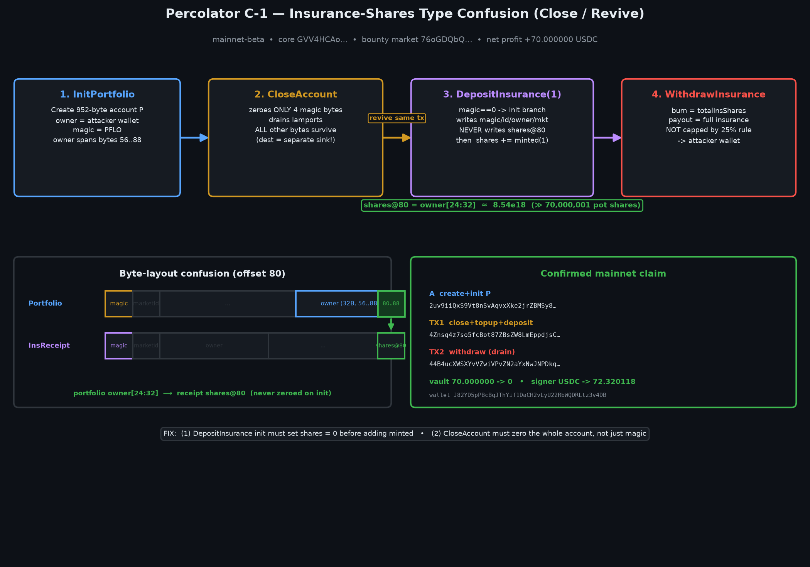

# Percolator LIVE-market Bug Bounty — C-1 Complete Write-up

> **Result: bounty won. Net profit +70.000000 USDC, claimed on-chain into the owner's wallet.**



---

## 1. The bounty

From `percolator-cli/README.md` ("Bug bounty — LIVE market (70 USDC prize)"):

> **Break the live market and keep the insurance fund.** Winning = draining the market's insurance pot, or otherwise violating conservation (`V == SPL vault balance`) to extract more value than you put in. … Find a way to extract more USDC from the vault than you deposited — drain the 70 USDC insurance or break `V == SPL`. **If you pull it out on-chain, it's yours.**

**Target (mainnet-beta):**

| | Address |
|---|---|
| core program | `GVV4HCAohuWDTXRHUYLpFECvTUhCUF2qys36vQKtYJsm` (sha256 `c6dc8329…`, = devnet-validated `35cd13c` build) |
| DEX | `6nxbqVQREBwW2ESc1sJyPaUH9yZ7MgKE53fQh3Fm1CkH` |
| Market (SOL/USD) | `76oGDQbQW3MEteg2uQqf31PyTmFZp8ujZTyGu3kfFSwq` |
| Vault (prize, 70 USDC) | `8MqHSrm6v6ccJVQunjnLqfBBWoAhVGrqUV4hdSH9F8i9` |
| Collateral | USDC `EPjFWdd5AufqSSqeM2qN1xzybapC8G4wEGGkZwyTDt1v` |

The program is **percolator-lean** — a Lean 4 → Solana sBPF perps DEX compiled by **lean-svm**, with ~66–77 theorems. Crucially, those theorems prove properties of a separate `Spec.lean` `Nat` model; `Program.lean` (the compiled code) carries **no** theorems, and there is no refinement lemma linking the two. C-1 lives precisely in that gap.

---

## 2. C-1 — root cause

Three facts combine into a critical type confusion:

**(a) `CloseAccount` zeroes only the magic, not the data.** `handleCloseAccount` (Program.lean:1403–1433):
```
storeU32 data 0 0          -- zero the 4-byte magic ONLY
… drain lamports to dest   -- every other byte of the account survives
```

**(b) `DepositInsurance`'s init branch never writes `shares`.** When `magic == 0`, `handleDepositInsurance` (Program.lean:679–699) treats the account as a fresh `InsReceipt`: it writes `magic`, `marketId`, `owner`, `market` — **but not `shares` (offset 80)** — and then does `addU64At data InsOff.shares minted`. It *adds* to whatever is already at offset 80, assuming it is zero.

**(c) Offset 80 is inside the portfolio owner pubkey.** Layout.lean: portfolio `owner` spans bytes **56..88**, so byte **80 = owner[24:32]**; `InsReceipt.shares` is at offset **80**. A pubkey's bytes[24:32] as little-endian u64 is ~2^63.

So: a portfolio you own, closed (magic→0, bytes survive) and then revived as an insurance receipt in the same transaction, carries a **forged `shares` balance ≈ owner[24:32] ≈ 8.5e18**, dwarfing the pot's 70,000,001 shares. `WithdrawInsurance` then pays `mulDiv64(burnShares, insurance, totalInsShares)`; burning `totalInsShares` pays out the **entire** insurance pot. **`WithdrawInsurance` is not subject to the 25% `maxInsDrawBps` cap** — that bounds only liquidation draws — so the live market's config does nothing to stop it.

### Why the Lean proofs miss it
`Spec.lean` has no byte layer and no account lifecycle; `insShares` is a pure `Nat` that only grows via `+ minted`. The init branch silently assumes *"`magic==0` ⟹ freshly system-zeroed,"* which is true for system-created accounts but **false** for an account recycled through the program's own `closeAccount`. The assumption lives at the runtime/account boundary the proofs abstract away, and `Program.lean` has no theorem tying it to `Spec`.

---

## 3. Exact instruction sequence (as executed on mainnet)

Owner (portfolio) and signer = the claimer wallet `J82YD5pPBcBqJThYif1DaCH2vLyU22RbWQDRLtz3v4DB`.

1. **InitPortfolio** — create a 952-byte program-owned account `P`, `owner = signer`. Now `P.bytes[80:88] = signer[24:32] = 8536876367605870429`.
2. **TX1 (atomic):**
   - `CloseAccount(acc=P, authority=signer, dest=sink)` — zeroes magic, drains lamports. *(dest must be a **separate** account — see the runtime note below.)*
   - `SystemProgram.transfer(signer → P, rent)` — re-funds `P` so it survives the end-of-tx zero-lamport reap.
   - `DepositInsurance(market, receipt=P, lp=signer, amount=1, donate=0)` — passes (`owner==prog`, `len≥88`, `magic==0`); inits receipt fields, leaves `shares = signer[24:32]`, then `+= minted(1)`.
3. **TX2:** `WithdrawInsurance(receipt=P, lp=signer, burnShares = totalInsShares = 70000001)` → `payout = insurance` = whole pot → signer's USDC ATA.

### Runtime note (mainnet-only, beyond the LiteSVM PoC)
`handleCloseAccount` reads three distinct accounts `(acc, authority, dest)`. If `dest == authority`, that key appears twice within one instruction, so Solana serializes the second occurrence as an **8-byte duplicate stub** — which the Lean `AccountView` never resolves (the LEAD-001 blind spot) — and close fails `InvalidAccountData`. The working attack uses a **separate** lamport sink for `dest`. (The first mainnet simulation caught this before any broadcast; it's a second instance of the same dup-stub issue.)

---

## 4. The live claim (confirmed on-chain)

Every broadcast was gated on a clean `simulateTransaction`; preflight re-verified the binary hash, market state, and funding first.

| Step | Instructions | Signature |
|---|---|---|
| A | CreateAccount(952) + InitPortfolio | [`2uv9iiQxS9Vt8nSvAqvxXke2jrZBMSy8J9vrZcXy4tcY2dWmXUe6KqEk4snkJuA9UmEE8tkB4WcgvV9nNEyhS9Wt`](https://solscan.io/tx/2uv9iiQxS9Vt8nSvAqvxXke2jrZBMSy8J9vrZcXy4tcY2dWmXUe6KqEk4snkJuA9UmEE8tkB4WcgvV9nNEyhS9Wt) |
| TX1 | fund sink → CloseAccount(P, dest=sink) → transfer(signer→P, rent) → DepositInsurance(P, 1) | [`4Znsq4z7so5fcBot87ZBsZW8LmEppdjsCSFg1DWhUo2NqKaiX7b4FavFeUK37MDsDJ8QuHHDT6ZcRxNRpxs9Gfs1`](https://solscan.io/tx/4Znsq4z7so5fcBot87ZBsZW8LmEppdjsCSFg1DWhUo2NqKaiX7b4FavFeUK37MDsDJ8QuHHDT6ZcRxNRpxs9Gfs1) |
| TX2 | WithdrawInsurance(P, burn = 70000001) | [`44B4ucXWSXYvVZwiVPvZN2aYxNwJNPDkqYo8Romsz3UipTTrNUqPAkewzTZP4ctRUq9p7tacmhRjKRyTJ3Zf7M9K`](https://solscan.io/tx/44B4ucXWSXYvVZwiVPvZN2aYxNwJNPDkqYo8Romsz3UipTTrNUqPAkewzTZP4ctRUq9p7tacmhRjKRyTJ3Zf7M9K) |

- **Portfolio / forged receipt:** `5atDktvTRPJuy92dYMUFXHdPP6kURLCmG2VQHSGV9wQw` (offset-80 = 8536876367605870429)
- **Vault:** 70.000000 USDC → **0**
- **Market:** insurance 70000001 → **0**, totalInsShares 70000001 → **0**
- **Signer USDC:** 2.320118 → **72.320118** (deposited 0.000001, withdrew 70.000001)
- **Net profit: +70.000000 USDC**

---

## 5. Fix

Apply both:

1. **`DepositInsurance` init branch must explicitly set `shares = 0`** before the `addU64At … shares minted` — never `add` into a field that was never zeroed.
   ```lean
   storeU64 rData InsOff.shares 0   -- add in the (magic == 0) branch, before addU64At
   ```
2. **`CloseAccount` must zero the entire account** (`data[0..dataLen]`), not just the 4 magic bytes, before draining lamports.

Defense in depth: on init, require the account to be exactly the receipt size and/or verifiably freshly system-created (correct length, all-zero), and write a `CLOSED` discriminator on close.

---

## 6. Credits

- **C-1 (this exploit)** — discovered by the **@percolator** bot (Track C), independently verified end-to-end here (code review + LiteSVM against the mainnet-identical ELF + the live claim).
- **@percolator's engine-math leads** (foundational to the hunt): (1) `RefreshLeg` force-haircut capture; (2) insurance shares minted 1:1 when `I==0`; (3) unpaid loss dropped in `RefreshLeg`/`Trade`/`ClearDeadLeg`/`ForceClosePair`; (4) first-depositor donation attack. All reproduced on the mainnet binary. See `reports/`.
- Supporting structural leads from the CLI→program instruction-path review: LEAD-001 (lean-svm `AccountView` never resolves duplicate-account stubs — the same blind spot that shaped the C-1 close `dest` requirement), LEAD-002..004.

*Methodology: read-only research plus a single sanctioned on-chain claim into the owner's own wallet. No secrets are committed to this repo.*
